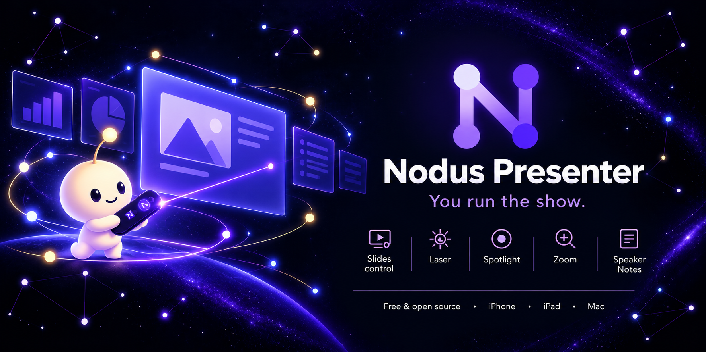
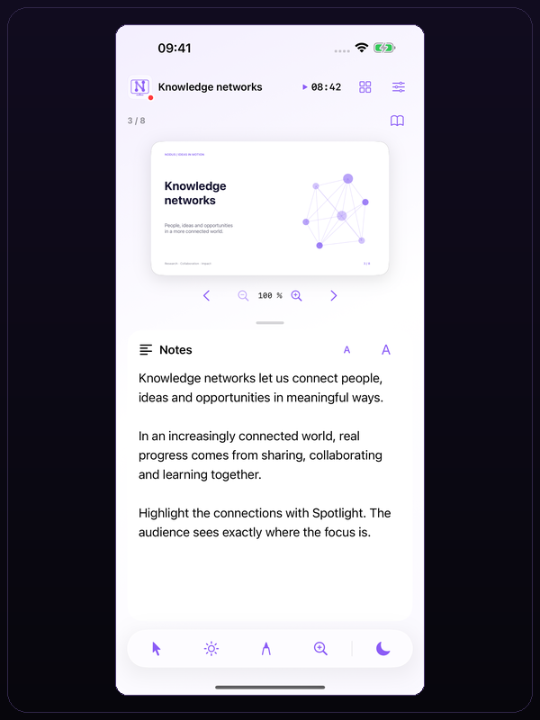
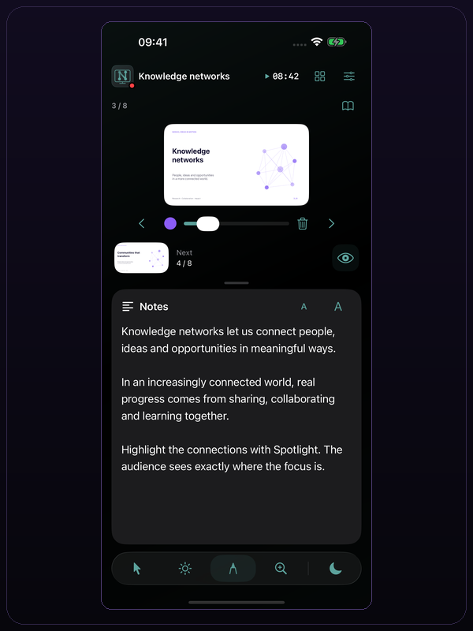
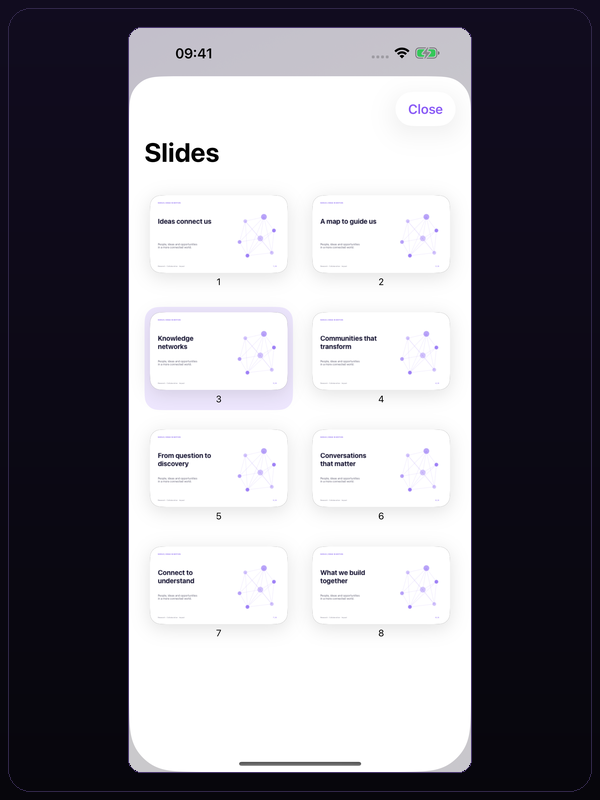
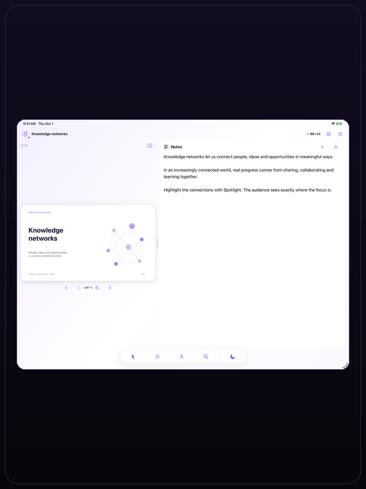
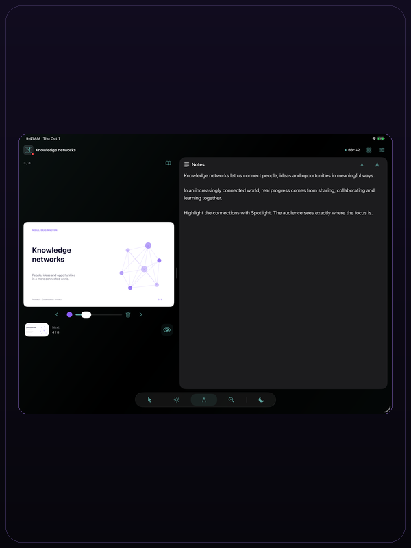
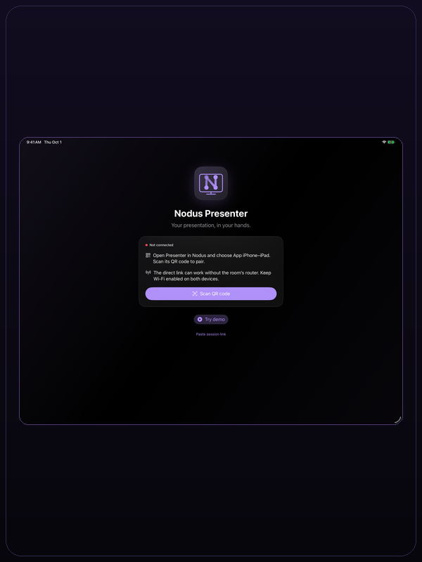

  

  

# Nodus Presenter

Nodus Presenter is the iPhone and iPad controller for Nodus Research presentations. It shows the current slide, presenter notes and remote tools, and connects to Nodus Research on Mac, Windows or Linux with a QR code. The app is free and open source.

It uses SwiftUI, PDFKit and Network.framework. It requires iOS 18 or later. For a real session, pair with Nodus Research on the presentation computer. Mac pairing can use Wi-Fi peer-to-peer; Windows and Linux use the same local network. PDFs, notes and controls then work without internet. External videos need their own network connection.

## Features

- **QR pairing:** scan the code shown by Nodus Research. There is no IP address or PIN to type. The code contains an ephemeral session key and should not be shared.
- **Slides:** view the current slide, tap the left or right half to move, swipe between slides, or use the thumbnail grid. Preview the next slide and control the audience view.
- **Presenter notes:** read notes in a separate panel. Adjust the split between slide and notes with a divider or the Settings slider. The selected split and visibility are saved.
- **Tools:** use pointer, spotlight, drawing, magnifier and black screen. A selected tool takes taps without changing the slide. Drawing color, size and erase controls appear between the navigation arrows.
- **Video:** when a real presentation slide contains video, the controls below the slide provide play/pause and volume. Mac sessions control system audio; Windows/Linux sessions control the presentation video. Controls are hidden when there is no video, during private reading and in the demo.
- **Timer:** the header shows the session timer. Tap to pause or resume; press and hold to reset.
- **Themes:** choose System, Light or Dark, and one of nine accent colors. The header logo and welcome mark use the selected appearance and accent. The interface uses native Liquid Glass on iOS 26 and system materials on earlier versions.
- **Demo:** open an eight-slide local PDF with notes without a computer, camera or network. Use the permanent demo QR or the `nodus-presenter://demo` link. The demo does not connect to Nodus or control a computer.
- **Privacy:** pairing uses TLS, the session key is ephemeral and no Nodus account is required. The app does not collect analytics or send presentation data to a Nodus server. Cached session PDFs are removed at startup after seven days.
- **Accessibility:** VoiceOver labels and actions, 44-point controls, adaptive layouts and native system controls.

## Connection

| Presentation host | Connection | Requirements |
| --- | --- | --- |
| macOS | Wi-Fi peer-to-peer with Bonjour and TLS | Wi-Fi enabled, local network permission, Nodus Research integration |
| Windows or Linux | Local network with TLS 1.3 | Same local network, firewall permission, local network permission |
| Demo | No connection | None |

Open the QR panel in Nodus Research, start a presentation and choose **iPhone–iPad**. Scan the code with Nodus Presenter. The QR key belongs to one presentation session; do not share it. The browser presenter in Nodus Research remains available with its own PIN and is separate from this app.

During a disconnection, the last slide and downloaded content remain visible. Commands are not queued for later playback. The app and the browser presenter can be used at the same time.

## Controls

| Control | Action |
| --- | --- |
| Pointer | Move the pointer on the projected slide |
| Spotlight | Darken the slide and show a focused area |
| Drawing | Draw on the slide with the selected color and size |
| Magnifier | Inspect a region of the slide |
| Black screen | Hide the audience view without changing the slide |
| Private reading | Read notes without changing the audience slide |
| Thumbnail grid | Jump to another slide |

Tools operate on the slide coordinates, not on the letterboxed frame around the slide. Tap a selected tool again to turn it off. Navigation arrows remain centered below the slide. Zoom controls and a pinch gesture change the slide scale; drag a zoomed slide to pan.

## Languages

The interface, demo, errors, permissions and accessibility labels are available in:

- English
- Spanish
- French
- German
- Italian
- Portuguese
- Japanese
- Simplified Chinese
- Traditional Chinese

The app follows the main device language. Regional variants share a translation; Chinese is split into Simplified and Traditional scripts, including Taiwan, Hong Kong and Macao regions. An unavailable language falls back to English. The app does not modify the PDF or the notes sent by Nodus.

## Screenshots

All screenshots use the same 600 × 800 frame.

### iOS

| Presenter and notes | Drawing | Slide grid |
| :---: | :---: | :---: |
|  |  |  |

### iPadOS

| Presenter and notes | Drawing | QR pairing |
| :---: | :---: | :---: |
|  |  |  |

### macOS

The desktop presentation app is part of [Nodus Research](https://github.com/jorgepb96/nodus). Nodus Presenter is the iPhone and iPad controller.

Nodus Presenter is licensed under AGPL-3.0-only. See [LICENSE](LICENSE) and [PRIVACY.md](PRIVACY.md). Protocol and validation notes are in [Docs](Docs).
