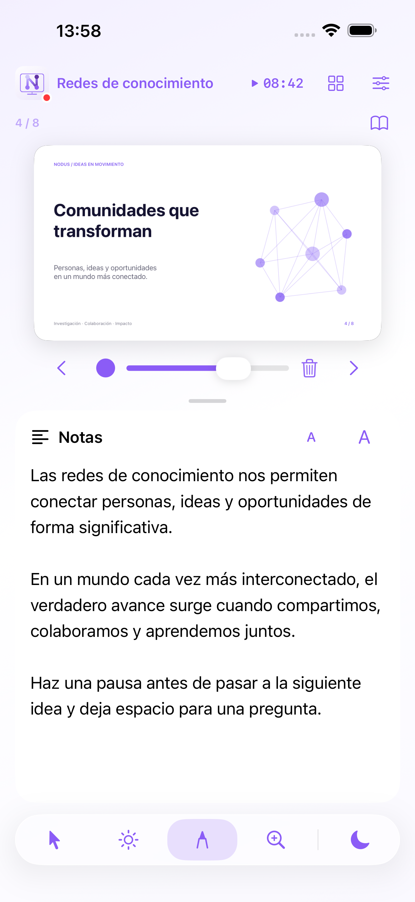

# Nodus Presenter

Aplicación nativa para iPhone y iPad que controla el PDF Presenter de Nodus. SwiftUI, PDFKit y Network.framework, sin dependencias externas. iOS 18 o posterior; Liquid Glass nativo en iOS 26 y materiales del sistema en versiones anteriores.

## Usar

En Nodus para macOS, inicia una presentación, abre el QR y selecciona **App iPhone–iPad**. Escanéalo desde esta app. El QR contiene una clave efímera para esa presentación: no lo compartas. El acceso **Navegador web** de Nodus continúa disponible con su PIN.

El enlace admite Wi-Fi entre dispositivos Apple (`includePeerToPeer`) sin crear un hotspot ni cambiar la red del Mac. Ambos dispositivos deben mantener Wi-Fi encendido y autorizar el acceso a la red local. El sistema elige la ruta disponible; la interfaz no presenta una conexión como directa si no puede comprobarla. No necesita internet para PDF, notas o controles. Los vídeos externos siguen necesitando conexión a su proveedor.

La demo funciona sin Mac, sin cámara y sin red. Genera un PDF local de ocho diapositivas, notas y estado de vídeo simulado. El punto verde indica un estado recibido de Nodus en una sesión autenticada; la demo y la reconexión muestran rojo, además de texto.

## Controles

Las notas tienen su propio panel de lectura. Ajusta el reparto entre diapositiva y notas con el separador o el slider de Ajustes; en este último, el tamaño se aplica al soltar para mantener estable la hoja. El slider y el separador se detienen cuando la diapositiva ocupa el ancho disponible; en la distribución por columnas, cuando ocupa toda la altura útil. El límite se adapta a su proporción, al tamaño de la ventana y a la vista de la siguiente diapositiva. La siguiente diapositiva se puede mostrar u ocultar. El tema, el reparto y esta opción se conservan al cerrar la app. Hay nueve acentos, nombrados solo por su color: Violeta, Índigo, Cian, Carmesí, Naranja, Verde azulado, Ámbar, Azul y Púrpura. Los identificadores anteriores se conservan para mantener tus preferencias.

En Ajustes → Tema, selecciona **Sistema**, **Claro** u **Oscuro**. La apariencia se guarda junto con el tema. El logo de la cabecera y la pantalla inicial es vectorial: tanto su superficie como el símbolo adoptan la apariencia y el acento seleccionado. En oscuro, los acentos se aclaran conservando su tono; texto y superficies usan los colores semánticos del sistema, y Liquid Glass adapta sus materiales automáticamente.

Las flechas están centradas justo debajo de la diapositiva. Toca la mitad izquierda para retroceder y la derecha para avanzar, o usa el deslizamiento y la cuadrícula de miniaturas. Una herramienta activa recibe esos toques sin cambiar de diapositiva; su color, tamaño y borrado aparecen entre las flechas. Amplía o reduce la diapositiva con los botones o el gesto de pinza; arrastra una diapositiva ampliada para desplazarte por ella. El cronómetro está en la cabecera: un toque pausa o inicia, y mantenerlo pulsado lo reinicia.

Una única barra inferior reúne puntero, Spotlight, dibujo, lupa y pantalla negra. Al pulsar una herramienta o la luna/sol durante la lectura privada, vuelves a la diapositiva que ve el público y se ejecuta la acción, sin avanzar la presentación. Si esa herramienta ya estaba activa, continúa seleccionada; otro toque la desactiva. También hay botones de fuente de 44 puntos separados, volumen del Mac y reproducción/búsqueda del vídeo asociado. Las herramientas actúan sobre las coordenadas de la diapositiva, sin las bandas del encuadre. Durante una desconexión se conserva la última vista y el contenido descargado; no se guardan órdenes para reproducirlas más tarde.

## Idiomas

La interfaz, la demo, los errores, los permisos y las etiquetas de accesibilidad están disponibles en inglés, español, francés, chino simplificado y tradicional, japonés, alemán, italiano y portugués. La app usa automáticamente el idioma principal del dispositivo. Las variantes regionales comparten traducción; el chino distingue escritura simplificada/tradicional y las regiones de Taiwán, Hong Kong y Macao. Un idioma principal no disponible usa inglés. No modifica los PDF ni las notas enviados desde Nodus.

El catálogo está en `Localization/translations.json`. Ejecuta `python3 Scripts/generate-localizations.py` después de editarlo para regenerar los recursos nativos `.strings` y los mensajes de permisos. El generador y los tests comprueban cobertura y argumentos de formato. XCUITest arranca cada idioma mediante `-AppleLanguages`, sin cambiar el idioma del dispositivo, y comprueba también el fallback desde ruso.

## Construir y comprobar

```sh
brew install xcodegen
Scripts/configure-project.sh
swift test
xcodebuild -project NodusPresenter.xcodeproj -scheme NodusPresenter \
  -destination 'platform=iOS Simulator,name=Nodus — iPhone 16 Pro Max' CODE_SIGNING_ALLOWED=NO test
```

Abre `NodusPresenter.xcodeproj`. El equipo de firma se puede cambiar en `project.yml`. Argumentos de ejecución: `--demo`, `--demo --tools`, `--demo --slides`. `--reset-preferences` restaura los ajustes visuales para las pruebas. `--pair <url>` se reserva para pruebas locales del protocolo; no uses claves reales en argumentos.

Para revisar el diseño en el Mac, compila con destino **Mac Catalyst** y ejecuta la app con `--demo`. Esta vista permite probar el mismo código SwiftUI; la validación final de gestos y conexión debe hacerse en iPhone/iPad.

`Scripts/configure-project.sh` detecta el SDK: con iOS 27.1 o posterior activa `NODUS_FOLDABLE_SDK`, que usa `ArrangementView` y `onHingeChange` para separar superficie y notas al plegar. Con SDK 26.2 compila el diseño por anchura y conserva la misma sesión al redimensionar. La rama específica de bisagra todavía necesita validación con SDK 27.1 y hardware plegable; las capturas anchas no son prueba de bisagra.

## Arquitectura y beta

[Protocolo](Docs/Protocol.md) · [Pruebas y límites](Docs/Validation.md) · [TestFlight](Docs/TestFlight.md) · [Privacidad](PRIVACY.md)

[Conceptos generados](Design/) y [capturas reales del simulador](Screenshots/) están separados. `App/NodusLogo.swift` dibuja la geometría del logo original de Nodus dentro de una pantalla con colores adaptativos. `Scripts/generate-icon.swift` regenera el icono del sistema.



Licencia AGPL-3.0; se conserva el archivo LICENSE del repositorio original.
