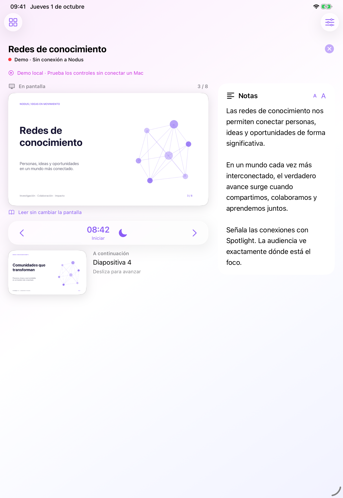

# Nodus Presenter

Aplicación nativa para iPhone y iPad que controla el PDF Presenter de Nodus. SwiftUI, PDFKit y Network.framework, sin dependencias externas. iOS 18 o posterior; Liquid Glass nativo en iOS 26 y materiales del sistema en versiones anteriores.

## Usar

En Nodus para macOS, inicia una presentación, abre el QR y selecciona **App iPhone–iPad**. Escanéalo desde esta app. El QR contiene una clave efímera para esa presentación: no lo compartas. El acceso **Navegador web** de Nodus continúa disponible con su PIN.

El enlace admite Wi-Fi entre dispositivos Apple (`includePeerToPeer`) sin crear un hotspot ni cambiar la red del Mac. Ambos dispositivos deben mantener Wi-Fi encendido y autorizar el acceso a la red local. El sistema elige la ruta disponible; la interfaz no presenta una conexión como directa si no puede comprobarla. No necesita internet para PDF, notas o controles. Los vídeos externos siguen necesitando conexión a su proveedor.

La demo funciona sin Mac, sin cámara y sin red. Genera un PDF local de ocho diapositivas, notas y estado de vídeo simulado. El punto verde indica un estado recibido de Nodus en una sesión autenticada; la demo y la reconexión muestran rojo, además de texto.

## Controles

Diapositiva actual y siguiente, navegación con botones/deslizamiento, miniaturas, notas ajustables, lectura privada, cronómetro compartido, pantalla negra, Spotlight, puntero, dibujo, lupa, zoom de diapositiva con gesto, volumen del Mac y reproducción/búsqueda del vídeo asociado. Las herramientas actúan sobre las coordenadas de la diapositiva, sin las bandas del encuadre. Durante una desconexión se conserva la última vista y el contenido descargado; no se guardan órdenes para reproducirlas más tarde.

## Construir y comprobar

```sh
brew install xcodegen
Scripts/configure-project.sh
swift test
xcodebuild -project NodusPresenter.xcodeproj -scheme NodusPresenter \
  -destination 'platform=iOS Simulator,name=iPhone 17 Pro' CODE_SIGNING_ALLOWED=NO test
```

Abre `NodusPresenter.xcodeproj`. El equipo de firma se puede cambiar en `project.yml`. Argumentos de ejecución: `--demo`, `--demo --tools`, `--demo --slides`. `--pair <url>` se reserva para pruebas locales del protocolo; no uses claves reales en argumentos.

Para revisar el diseño en el Mac, compila con destino **Mac Catalyst** y ejecuta la app con `--demo`. Esta vista permite probar el mismo código SwiftUI; la validación final de gestos y conexión debe hacerse en iPhone/iPad.

`Scripts/configure-project.sh` detecta el SDK: con iOS 27.1 o posterior activa `NODUS_FOLDABLE_SDK`, que usa `ArrangementView` y `onHingeChange` para separar superficie y notas al plegar. Con SDK 26.2 compila el diseño por anchura y conserva la misma sesión al redimensionar. La rama específica de bisagra todavía necesita validación con SDK 27.1 y hardware plegable; las capturas anchas no son prueba de bisagra.

## Arquitectura y beta

[Protocolo](Docs/Protocol.md) · [Pruebas y límites](Docs/Validation.md) · [TestFlight](Docs/TestFlight.md) · [Privacidad](PRIVACY.md)

[Conceptos generados](Design/) y [capturas reales del simulador](Screenshots/) están separados. El icono dibuja la geometría del logo original de Nodus dentro de una pantalla; `Scripts/generate-icon.swift` permite regenerarlo.



Licencia AGPL-3.0; se conserva el archivo LICENSE del repositorio original.
